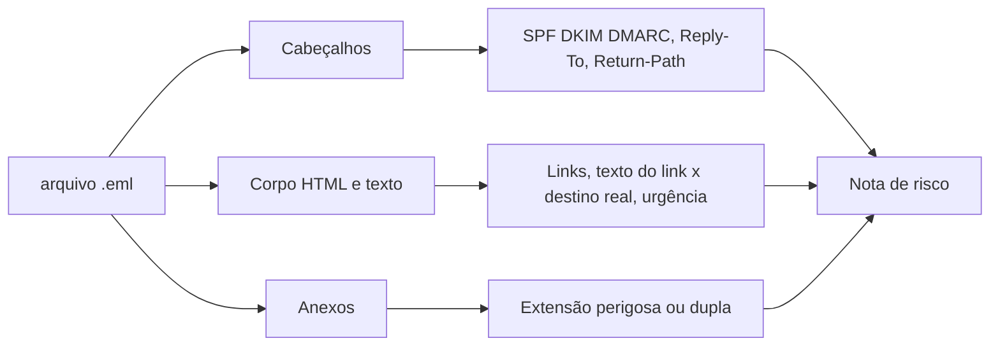

<p align="center"><sub>Phishing Analyzer</sub></p>

---

<p align="center">
  
</p>

<p align="center">
  Analisa e-mails .eml e pontua SPF, DKIM, DMARC, links disfarçados e anexos perigosos
</p>

<p align="center">
  
  
  <a href="https://github.com/arthurlynow098/phishing-analyzer/actions/workflows/testes.yml"></a>
  
</p>

## Sobre o projeto

Phishing ainda é a porta de entrada mais comum de ataque. Todo mundo já recebeu o "sua conta foi bloqueada, clique aqui". Num SOC, alguém precisa olhar o e-mail que o usuário reportou e decidir rápido se é golpe ou não.

O Phishing Analyzer faz essa triagem inicial. Você passa o arquivo `.eml` (no Outlook e no Gmail dá para baixar a mensagem original) e ele lê os cabeçalhos, os links e os anexos **sem abrir nada**, soma os sinais suspeitos e devolve uma nota de 0 a 100.

## Como funciona



## Tecnologias

<p>
  
  
  
  
</p>

## Executando o código

Só precisa de Python 3.10 ou mais novo. Tem dois e-mails de exemplo em `exemplos/`, um golpe e um legítimo, ambos com domínios `.example` que não existem.

```bash
git clone https://github.com/arthurlynow098/phishing-analyzer.git
cd phishing-analyzer

python -m phishanalyzer exemplos/suspeito.eml
python -m phishanalyzer exemplos/*.eml --json
```

Testes

```bash
pip install -r requirements-dev.txt
python -m pytest -q
```

## Exemplo

```text
  arquivo   exemplos/suspeito.eml
  assunto   URGENTE Sua conta foi bloqueada, regularize imediatamente
  de        Nubank Segurança <alerta@seguranca-conta.example>
  responder suporte.cliente.2026@webmail-gratis.example
  auth      SPF softfail  DKIM none  DMARC fail

  risco     ■■■■■■■■■■ 100/100, muito provavelmente phishing

   +25  DMARC falhou
   +25  anexo de tipo perigoso
        comprovante.pdf.html
   +25  texto do link mostra um site e leva para outro
        mostra www.nubank.com.br e abre nubank-verificacao-acesso.example
   +20  Reply-To diferente do remetente
   +20  nome de exibição imita uma marca
   +20  linguagem de urgência ou ameaça
        urgente, imediatamente, bloqueada, confirme seus dados, regularize

  links encontrados (não clique)
   hxxp://nubank-verificacao-acesso.example/login?id=8812
   hxxps://bit.ly/3xExemplo
```

O e-mail legítimo do exemplo, com SPF, DKIM e DMARC passando, recebe nota 0.

## Estudei por aqui

Segui essas aulas e materiais para entender e aplicar tudo que está aqui.

| Material | O que tirei dele |
|---|---|
| [TryHackMe, Phishing Analysis Fundamentals](https://tryhackme.com/room/phishingemails1tryoe) | Cabeçalhos, estrutura de um e-mail e os tipos de golpe |
| [MITRE ATT&CK T1566, Phishing](https://attack.mitre.org/techniques/T1566/) | Variações do ataque e o que dá para detectar |
| [RFC 7208, SPF](https://datatracker.ietf.org/doc/html/rfc7208) | Os resultados possíveis do SPF (pass, fail, softfail) |
| [Documentação do módulo email](https://docs.python.org/3/library/email.html) | Leitura de mensagens MIME em Python |

## Licença

Distribuído sob a licença MIT. Veja o arquivo [LICENSE](LICENSE).

<p align="center"><sub>A gravura do banner é o peixe-diabo da Encyclopaedia Britannica de 1911, em domínio público no <a href="https://commons.wikimedia.org/wiki/File%3A1911_Lophius_piscatorius.png">Wikimedia Commons</a>.</sub></p>
