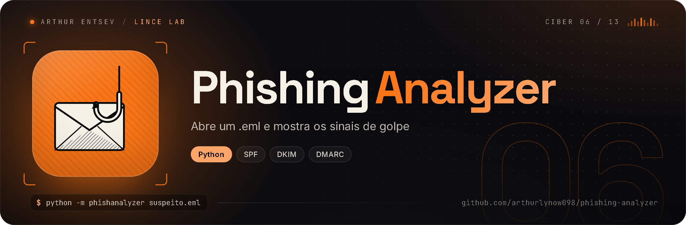
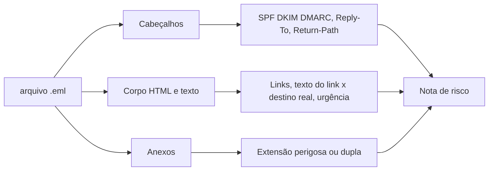

<a id="top"></a>

<p align="center"></p>

<p align="center">


<a href="https://github.com/arthurlynow098/phishing-analyzer/actions/workflows/testes.yml"></a>

</p>

<p align="center"><a href="#sobre">Sobre</a> &nbsp;&nbsp; <a href="#como-funciona">Como funciona</a> &nbsp;&nbsp; <a href="#rodando">Rodando</a> &nbsp;&nbsp; <a href="#aprendi">O que aprendi</a> &nbsp;&nbsp; <a href="#estudos">Estudos</a></p>

<a id="sobre"></a>

<p></p>

Phishing ainda é a porta de entrada mais comum de ataque. Todo mundo já recebeu o "sua conta foi bloqueada, clique aqui". Num SOC, alguém precisa olhar o e-mail que o usuário reportou e decidir rápido se é golpe ou não.

O Phishing Analyzer faz essa triagem inicial. Você passa o arquivo `.eml` (no Outlook e no Gmail dá para baixar a mensagem original) e ele lê os cabeçalhos, os links e os anexos **sem abrir nada**, soma os sinais suspeitos e devolve uma nota de 0 a 100.

<a id="como-funciona"></a>

<p></p>



| O que é checado | Por que importa |
|---|---|
| **SPF, DKIM e DMARC** | Mostram se o servidor que mandou tinha autorização para usar aquele domínio |
| **Reply-To diferente** | O golpista manda de um endereço e quer a resposta em outro |
| **Nome de exibição** | "Nubank Segurança" escrito no nome, mas o endereço é de outro domínio |
| **Texto do link x destino** | O link mostra `www.nubank.com.br` mas abre outro site. É o truque mais clássico |
| **Domínio com nome de marca** | `nubank-verificacao.xyz` não é do Nubank |
| **IP, encurtador e punycode** | Formas de esconder para onde o link vai |
| **Anexo** | `.html`, `.exe`, `.iso` e extensão dupla como `comprovante.pdf.html` |
| **Urgência** | "bloqueada", "regularize imediatamente", pressão para a pessoa não pensar |

Detalhes que fiz de propósito

- Os links saem no relatório como `hxxp://` (defang), assim ninguém clica sem querer copiando do terminal
- Uso só a biblioteca padrão (`email` e `html.parser`), nada é renderizado e nenhum link é acessado
- Código de saída 1 quando a nota passa de 60, para dar para automatizar numa caixa de "reportar phishing"

<a id="rodando"></a>

<p></p>

Só precisa de Python 3.10 ou mais novo. Tem dois e-mails de exemplo em `exemplos/`, um golpe e um legítimo, ambos com domínios `.example` que não existem.

```bash
git clone https://github.com/arthurlynow098/phishing-analyzer.git
cd phishing-analyzer

python -m phishanalyzer exemplos/suspeito.eml
python -m phishanalyzer exemplos/*.eml --json
```

Testes

```bash
pip install -r requirements-dev.txt
python -m pytest -q
```

<p></p>

```text
  arquivo   exemplos/suspeito.eml
  assunto   URGENTE Sua conta foi bloqueada, regularize imediatamente
  de        Nubank Segurança <alerta@seguranca-conta.example>
  responder suporte.cliente.2026@webmail-gratis.example
  auth      SPF softfail  DKIM none  DMARC fail

  risco     ■■■■■■■■■■ 100/100, muito provavelmente phishing

   +25  DMARC falhou
   +25  anexo de tipo perigoso
        comprovante.pdf.html
   +25  texto do link mostra um site e leva para outro
        mostra www.nubank.com.br e abre nubank-verificacao-acesso.example
   +20  Reply-To diferente do remetente
   +20  nome de exibição imita uma marca
   +20  linguagem de urgência ou ameaça
        urgente, imediatamente, bloqueada, confirme seus dados, regularize

  links encontrados (não clique)
   hxxp://nubank-verificacao-acesso.example/login?id=8812
   hxxps://bit.ly/3xExemplo
```

O e-mail legítimo do exemplo, com SPF, DKIM e DMARC passando, recebe nota 0.

<a id="aprendi"></a>

<p></p>

- Como ler os cabeçalhos de um e-mail e o que cada um diz sobre a origem
- O que SPF, DKIM e DMARC verificam e por que um sem o outro não resolve
- A estrutura MIME, com partes de texto, HTML e anexos
- Defang de indicadores, uma prática comum em relatório de incidente
- Pensar em pesos em vez de regras sim ou não, porque nenhum sinal sozinho prova nada

Próximos passos

- [ ] Consultar a reputação dos domínios na API do VirusTotal
- [ ] Extrair hash dos anexos para buscar em bases de malware
- [ ] Gerar o relatório em HTML para anexar no chamado

<a id="estudos"></a>

<p></p>

Segui essas aulas e materiais para entender e aplicar tudo que está aqui.

| Material | O que tirei dele |
|---|---|
| [TryHackMe, Phishing Analysis Fundamentals](https://tryhackme.com/room/phishingemails1tryoe) | Cabeçalhos, estrutura de um e-mail e os tipos de golpe |
| [MITRE ATT&CK T1566, Phishing](https://attack.mitre.org/techniques/T1566/) | Variações do ataque e o que dá para detectar |
| [RFC 7208, SPF](https://datatracker.ietf.org/doc/html/rfc7208) | Os resultados possíveis do SPF (pass, fail, softfail) |
| [Documentação do módulo email](https://docs.python.org/3/library/email.html) | Leitura de mensagens MIME em Python |

<p align="center"><sub>Parte do <a href="https://github.com/arthurlynow098">Lince Lab</a>, minha coleção de projetos de cibersegurança</sub></p>

<p align="center"><a href="#top">Voltar ao topo</a></p>
